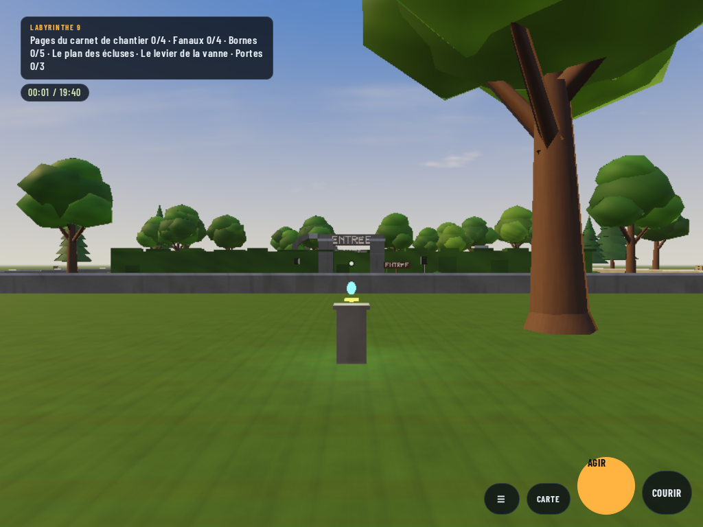

# HDF LABYRINTH 1.0

Jeu de labyrinthes de haies à la première personne de **F.S.M Game House**, construit sur le moteur 3D FSM3D de HDF WALL. Tout tient dans un seul fichier HTML autonome : `index.html`.

**Version 1.0** : c'est la première version complète. Elle propose deux campagnes, **Exploration** et **Horreur**. Chaque labyrinthe est généré aléatoirement, comporte des objectifs à remplir et raconte un épisode d'une histoire suivie.

## Écran titre

- **Exploration** : reprend votre campagne Exploration, ou en commence une nouvelle s'il n'y en a pas.
- **Horreur** : fonctionne de la même façon pour la campagne Horreur.
- **Continuer** : reprend la dernière campagne jouée, au labyrinthe où vous vous êtes arrêté.
- **Nouvelle campagne** : choix du mode, avec une **graine** facultative. Une même graine redonne exactement les mêmes labyrinthes, objectifs et textes.
- **Records**, **Options**, **Aide**, **Réinitialiser** (efface les campagnes sauvegardées).

Tous les menus se pilotent à la manette PS4, au clavier ou au toucher. Chaque mode a sa propre sauvegarde et ses propres records : plus haut labyrinthe atteint, nombre de labyrinthes franchis, chapitres terminés et meilleurs temps.

## Déroulement d'un labyrinthe

1. **Briefing** : le chapitre, le titre de l'épisode, le récit et la liste des objectifs. La graine y est affichée. Le labyrinthe se construit pendant ce temps, par étapes, sans bloquer l'écran.
2. **Objectifs** : il faut les remplir avant de pouvoir sortir. Selon le niveau, on trouve :
   - des feuillets ou pages à lire (chacun révèle un morceau d'histoire et s'ajoute au carnet) ;
   - une relique à rapporter ;
   - des lanternes à allumer ;
   - des sceaux à activer **dans l'ordre** (I, II, III…) ;
   - un levier ;
   - des portes de bois qui s'ouvrent chacune avec sa clé (clé → porte → clé suivante…).
3. **Clairière centrale**, puis **sortie au nord**. La herse de la sortie ne se lève qu'une fois tous les objectifs remplis et la clairière atteinte.
4. **Fin du labyrinthe** : un temps, un record éventuel et la suite du récit. Vous pouvez alors passer au labyrinthe suivant, rejouer le même ou revenir au titre.

Chaque partie est garantie faisable : le générateur vérifie par parcours en largeur (BFS) que tout est atteignable, y compris la chaîne clés/portes. Le menu pause donne accès au **carnet**, qui rassemble l'objectif en cours, la progression et les pages déjà lues.

## Mode Exploration (de jour)

Ambiance sérieuse mais calme, sans monstres. La difficulté monte de niveau en niveau :

| Labyrinthe | Taille | Objectifs |
|---|---|---|
| 1 | 9 × 9 | 1 feuillet, 1 relique |
| 2 | 11 × 11 | 2 feuillets, 1 relique |
| 3 | 13 × 13 | 2 feuillets, 2 lanternes, 1 relique |
| 4 | 15 × 15 | 3 feuillets, 3 lanternes, 1 porte à clé |
| 5 | 17 × 17 | 3 feuillets, 3 sceaux ordonnés, 1 porte |
| 6 | 19 × 19 | 3 feuillets, 3 sceaux, levier, 1 porte, relique |
| 7 | 21 × 21 | 4 feuillets, 3 lanternes, 4 sceaux, levier, 2 portes + temps conseillé |
| 8 | 23 × 23 | idem + relique |
| 9 et + | 25 × 25 | 4 feuillets, 4 lanternes, 5 sceaux, levier, 3 portes, relique + temps conseillé qui se resserre |

À partir du labyrinthe 7, un **temps conseillé** est affiché. Il n'entraîne aucune pénalité : seul le record le prend en compte.

## Mode Horreur (de nuit)

Le mode reprend la même structure que l'Exploration, avec en plus tout le mode horreur de la v1.3 :
- nuit et brouillard ;
- gardien(s) ;
- clés et grilles ;
- haies mouvantes ;
- lampe, lunettes de vision nocturne et piles, avec la roue d'accessoires (L1) ;
- clôture, portail qui se referme et voiture de police ;
- musique dynamique.

| Labyrinthe | Taille | Grilles | Gardiens | Pages | Haies mouvantes |
|---|---|---|---|---|---|
| 1 | 11 × 11 | 1 | 1 (plus lent) | 1 | 6 |
| 3 | 15 × 15 | 2 | 1 | 2 | 10 |
| 5 | 19 × 19 | 3 | 1 | 2 | 16 |
| 6 | 21 × 21 | 3 | 2 | 3 | 18 |
| 8 et + | 25 × 25 | 4 | 2 (plus rapides, perception accrue) | 3 | 24 |

Au fil des niveaux, la lampe dure moins longtemps, les piles se font plus rares et les haies bougent plus souvent. Aucun flash ni effet stroboscopique : l'option « Effets réduits » est conservée.

## Récit

Les deux campagnes suivent le fil de *L'Atlas des haies*, l'œuvre inachevée d'une cartographe fictive. Le récit avance en arcs de 5 à 7 labyrinthes, chacun avec ses chapitres, ses temps forts et un épilogue. Douze prémisses sont prévues, six de jour et six de nuit. Les textes sont choisis de façon déterministe à partir de la graine, et les morceaux d'histoire ne se répètent pas avant de nombreux niveaux. Chaque briefing s'ouvre aussi sur une ligne d'ambiance (météo, lumière, bruits), tirée de la graine parmi douze par mode : deux campagnes ne commencent donc pas tout à fait de la même façon.

## Commandes

| Action | Clavier / souris | Manette PS4 | Tactile |
|---|---|---|---|
| Avancer / reculer / pas de côté | ZQSD, WASD ou flèches | Stick gauche | Stick virtuel gauche |
| Regarder | Souris (clic pour capturer, Échap pour libérer) | Stick droit | Glisser le doigt |
| **Agir** (lire, prendre, allumer, activer, ouvrir) | E, Entrée ou Espace | ✕ (Croix) | Bouton Agir (ou toucher l'aide affichée) |
| Courir | Maj | R2 | Bouton Courir |
| Sprint | Ctrl | L3 (bascule) | — |
| Regard à l'horizon | R | R3 | — |
| Carte complète | M | R1 ou SHARE | Bouton Carte |
| Pause / carnet | Échap ou P | OPTIONS | Bouton ☰ |
| Horreur : lampe ou lunettes | F | □ | Bouton Lampe |
| Horreur : pile | T | △ | Bouton Pile |
| Horreur : roue d'accessoires | Maintenir X | Maintenir L1 | Bouton Accessoire |

Les commandes sont les mêmes que dans HDF WALL. Le jeu se joue uniquement à la première personne, sans mini-carte ; la carte complète reste disponible et montre les objectifs déjà aperçus, les portes et la herse.

## Technique

- Chaque niveau tire sa graine de la graine de campagne. Les labyrinthes vont de 9 × 9 à 25 × 25 et chacun est vérifié par BFS.
- La construction se fait par étapes derrière le briefing, donc sans gel sur iPad. Au plus grand niveau, on reste sous le budget iPad (moins de 150 Mo, environ 500 k triangles au maximum).
- Le correctif du moteur `G.roundBox` (r = 0) de la v1.3 est conservé.
- Les parties 1.x (v1.0 à v1.3) sont remplacées par les campagnes 1.0. Les options sont conservées.

